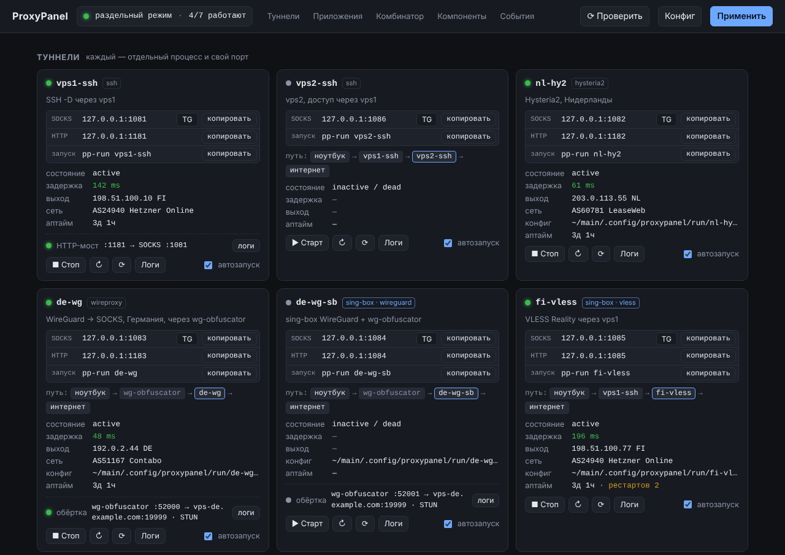

# ProxyPanel

Локальная веб-панель для SOCKS/HTTP-туннелей на Linux: **ssh, hysteria2, wireproxy, sing-box,
wg-obfuscator** — запуск, автозагрузка, проверка здоровья, цепочки, обновление бинарников.

*A local web panel for Linux that runs and supervises your proxy tunnels (ssh, hysteria2,
wireproxy, sing-box, wg-obfuscator) as systemd user services: one tunnel — one process —
one SOCKS/HTTP port, with chaining, health checks, desktop notifications and binary updates.
The UI and docs are in Russian.*



## Возможности

- **Каждый туннель — отдельно.** Свой процесс, свой порт, свой systemd user unit. Каждое
  приложение ходит в свой порт. Автозагрузка при старте системы, рестарт с нарастающей
  паузой, логи в journald.
- **Все популярные клиенты.** ssh/autossh, hysteria2, wireproxy и sing-box: vless, trojan,
  shadowsocks, tuic, wireguard… sing-box можно описать в YAML, загрузить объект из JSON
  или запустить свой полный конфиг.
- **wg-obfuscator как обёртка** для WireGuard (wireproxy или sing-box). Панель сама
  поднимает обфускатор и направляет на него Endpoint.
- **Цепочки «туннель через туннель»** (`via`) и **HTTP-прокси рядом с SOCKS** (`http_port`).
- **Проверки и уведомления.** Задержка, exit IP и страна; события «упал», «не отвечает»,
  «снова работает» на рабочем столе. Перед запуском панель проверяет: программа на месте,
  файл есть, порт не занят.
- **Обновления бинарников** с GitHub в `~/main/bin`: sha256, пробный запуск, откат.
- **`pp-run de-wg telegram-desktop`** запускает программу через нужный туннель: браузер
  получает свой профиль, Telegram — прокси. Есть ярлыки в меню приложений.
- **Комбинатор sing-box (опция).** Единый вход и автовыбор самого быстрого туннеля поверх
  тех же портов.

```
            Telegram ─► :1081 ─ pp-vps1-ssh      (autossh -D)
             Браузер ─► :1082 ─ pp-nl-hy2        (hysteria)
          IDE / curl ─► :1083 ─ pp-de-wg         (wireproxy) ─► pp-de-wg-obfs (wg-obfuscator) ─► сервер
                 ... ─► :1085 ─ pp-fi-vless      (sing-box) ─ via ─► :1081
  опция: всё сразу  ─► :1080 ─ pp-singbox       (комбинатор: select / urltest поверх портов выше)
```

## Быстрый старт

Ubuntu 24.04+ / Debian 12+ (systemd, Python ≥ 3.10). Запускать от обычного пользователя:

```bash
git clone https://github.com/ezyhook/proxypanel.git && cd proxypanel
./install.sh
```

Откройте http://127.0.0.1:8800 → «Конфиг». Опишите туннели (пример с комментариями
уже лежит в конфиге) → «Сохранить и применить».

`install.sh` делает следующее:
- ставит пакеты `python3-venv autossh libnotify-bin netcat-openbsd proxychains4`;
- кладёт приложение в `~/main/.local/share/proxypanel`, а `pp-run` — в `~/main/bin`
  (со ссылкой в `~/.local/bin`);
- включает linger — автозапуск сервисов до входа в систему;
- скачивает недостающие бинарники;
- на свежей установке кладёт пример `proxies.yaml` и образцы конфигов клиентов.

Повторный запуск обновляет панель, ваши конфиги он не трогает. Удаление: `./uninstall.sh`
(конфиги и `~/main/bin` остаются).

## Раскладка

| Путь | Что |
|---|---|
| `~/main/bin/` | sing-box, hysteria, wireproxy, wg-obfuscator (+ `*.old` для отката), `pp-run` |
| `~/main/.config/proxypanel/proxies.yaml` | ваш конфиг (бэкап `.yaml.bak` при сохранении из панели) |
| `~/main/.config/proxypanel/*.conf, *.yaml, *.json` | ваши конфиги клиентов (wireproxy, hysteria, sing-box…) |
| `~/main/.config/proxypanel/run/` | сгенерированное: скрипты, конфиги с подстановками, обфускаторы |
| `~/main/.local/share/proxypanel/` | приложение и venv |
| `~/.config/systemd/user/pp-*.service` | units (systemd читает их только отсюда) |

Корень `~/main` меняется переменной `PP_MAIN` (`PP_MAIN=/path ./install.sh`).
Относительные пути в `cmd` и конфигах клиентов считаются от `~/main/.config/proxypanel`.

## Туннели

### Внешний процесс: `cmd` и/или `config`

```yaml
nl-hy2:
  kind: hysteria2
  port: 1082
  config: hy2-nl.yaml        # cmd не нужен: hysteria client -c {config}
```

С `config` панель кладёт копию файла в `run/`, подставляет `{port}`, `{obfs}`, `{via}`… и
**сама выставляет порты**:
- wireproxy — `[Socks5]` и `[http] BindAddress`;
- hysteria — `socks5.listen` и `http.listen`.

Ваш исходный файл не меняется.

### Порты: одно место правды

Порт можно указать **в одном месте**, в `proxies.yaml` или в файле клиента:

| Где указан порт | Что делает панель |
|---|---|
| только в `proxies.yaml` (`port`, `http_port`) | дописывает его в копию файла клиента — **рекомендуется**: все порты видны в одном месте, и панель проверяет их на конфликты |
| только в файле клиента | берёт его оттуда; в карточке пометка «порты: из файла клиента» |
| в обоих местах и они разные | главный `proxies.yaml`, панель предупреждает о расхождении |

Поэтому в образцах `wireproxy-de.conf` и `hy2-nl.yaml` секций с портами больше нет.

### sing-box: три варианта на выбор (`kind: sing-box`)

```yaml
# 1) outbound/endpoint прямо в YAML
fi-vless:
  kind: sing-box
  port: 1085
  outbound: { type: vless, server: fi.example.com, server_port: 443, uuid: ..., tls: {...} }

# 2) тот же outbound/endpoint, но из JSON-файла (объект с полем "type", как экспорт из клиента)
nl-sb:
  kind: sing-box
  port: 1087
  config: sb-nl.json

# 3) полный конфиг sing-box: запускается как есть
my-sb:
  kind: sing-box
  port: 1088            # необязательно — иначе берётся из первого mixed/socks inbound файла
  config: full.json
```

- **Варианты 1 и 2.** Панель собирает отдельный процесс `sing-box run` (примерно 20–30 МБ
  памяти). Работают `via` (detour), `obfuscator` и `http_port`. В варианте 2 можно
  положить экспорт `{"type": "wireguard", …}` с `pre_shared_key`.
- **Вариант 3 — для своих сложных конфигов** (маршрутизация, несколько outbound'ов).
  Панель только ставит первый mixed/socks inbound на `port` (или добавляет его, если
  такого нет). При `http_port` она добавляет http-inbound, а при `via` проставляет
  `detour` всем прокси-outbound'ам.
- **`kind` можно не писать.** Для `outbound:`/`endpoint:` и для `config: *.json` панель
  сама поймёт, что это sing-box. В карточке туннеля показывается `sing-box · vless`.

### WireGuard: ключи, PSK и стиль wg-quick

Native-туннель с `endpoint: {type: wireguard}` принимает поля sing-box, включая
**`pre_shared_key`** (PresharedKey из wg-quick):

```yaml
de-wg-sb:
  port: 1084
  endpoint:
    type: wireguard
    address: [10.66.0.3/32]
    private_key: ...
    peers:
      - address: vps-de.example.com
        port: 51820
        public_key: ...
        pre_shared_key: ...          # wg genpsk; должен совпадать с серверным
        allowed_ips: [0.0.0.0/0]
        persistent_keepalive_interval: 25
```

Можно переносить настройки из wg-quick как есть, панель переведёт их в формат sing-box:

| wg-quick | sing-box |
|---|---|
| `PrivateKey` | `private_key` |
| `Address: 10.0.0.2/32, fd00::2/128` | `address: [...]` |
| `PublicKey` | `public_key` |
| `PresharedKey` / `preshared_key` / `psk` | `pre_shared_key` |
| `Endpoint: host:port` | `address` + `port` |
| `AllowedIPs: 0.0.0.0/0, ::/0` | `allowed_ips: [...]` |
| `PersistentKeepalive` | `persistent_keepalive_interval` |

PSK проверяется при сохранении: нужно 44 символа base64, как выдаёт `wg genpsk`.

У wireproxy `PresharedKey = …` пишется в `[Peer]` его конфига, как обычно. Панель этот
ключ не трогает, в том числе с обёрткой wg-obfuscator.

## Обёртка wg-obfuscator

Для WireGuard-туннелей: wireproxy или sing-box wireguard. Конфиг WireGuard остаётся обычным,
с **реальным** адресом сервера, а обфускатор описывается рядом:

```yaml
de-wg:
  kind: wireproxy
  port: 1083
  config: wireproxy-de.conf          # Endpoint = vps-de.example.com:19999
  obfuscator:
    key: мой-ключ                    # как на сервере
    masking: STUN
    in-timeout: 60

de-wg-sb:                            # то же силами sing-box
  port: 1084
  obfuscator: { key: мой-ключ, masking: STUN }
  endpoint:
    type: wireguard
    address: [10.66.0.3/32]
    private_key: ...
    peers: [{ address: vps-de.example.com, port: 19999, public_key: ..., allowed_ips: [0.0.0.0/0] }]
```

Панель:
1. Поднимает `pp-de-wg-obfs.service` с конфигом `source-lport = 52000`,
   `target = vps-de.example.com:19999`.
2. Переписывает Endpoint (или peer у sing-box) на `127.0.0.1:52000`. Это работает и для
   `WGConfig = …` у wireproxy.
3. Связывает units. Туннель тянет обфускатор при старте, а стоп или рестарт
   туннеля останавливает или перезапускает и обфускатор (`Requires` + `PartOf`).
   Если упал обфускатор, туннель перезапускается и быстрее переподключается.

В карточке туннеля обфускатор виден отдельной строкой со статусом и своими логами, а в
пути трафика показан так: `ноутбук → wg-obfuscator → de-wg → интернет`.

Параметры: `key` (обяз.), `target` (по умолчанию из конфига), `masking` (STUN/AUTO/NONE),
`in-timeout`, `resolve-interval`, `max-dummy`, `idle-timeout`, `listen_port` (с 52000).

Ещё две подсказки:
- **MTU и keepalive.** Masking STUN добавляет байты к пакетам, поэтому ставьте
  `MTU = 1380` или меньше и `PersistentKeepalive = 25`.
- **Отдельный процесс.** Если нужен просто обфускатор (например, для системного
  `wg-quick`), используйте `kind: wg-obfuscator` с `config:`.

## Цепочки (`via`)

| Что | Как | Пример |
|---|---|---|
| ssh/autossh | автоматически `ProxyCommand=nc -X 5 -x 127.0.0.1:PORT %h %p` | `vps2-ssh: {via: vps1-ssh, …}` |
| native | `detour` через SOCKS-порт верхнего туннеля | `fi-vless: {via: vps1-ssh, outbound: …}` |
| остальные | подстановки `{via}`, `{via_url}`, `{via_host}`, `{via_port}` в cmd/config | |
| через группу | `via: auto` — нужен комбинатор и `port` у группы | |

Unit цепочки получает `Requires/After` на верхний туннель. UDP-протоколы (hysteria2,
wireguard, tuic) через `ssh -D` не проходят: внешний процесс панель не пропустит, а для
native выдаст предупреждение.

## HTTP-прокси рядом с SOCKS (`http_port`)

Некоторые программы не умеют SOCKS: apt, часть Electron- и Java-приложений, старые утилиты.
Укажите `http_port`, и у туннеля появится ещё и HTTP-прокси:

| Туннель | Кто отдаёт HTTP |
|---|---|
| wireproxy (с `config`) | сам wireproxy: панель допишет `[http] BindAddress` |
| hysteria (с `config`) | сама hysteria: `http.listen` |
| native (sing-box) | основной `port` уже понимает и SOCKS, и HTTP; `http_port` — отдельный HTTP-вход |
| остальные (ssh, …) | мост HTTP→SOCKS на sing-box: `pp-<имя>-http.service`, стартует и останавливается вместе с туннелем |

Проверка здоровья проверяет и HTTP-вход. Если он не отвечает, в карточке появится пометка.

## Запуск программы через туннель: `pp-run`

```bash
pp-run -l                            # туннели, порты, состояние
pp-run de-wg telegram-desktop        # Telegram через de-wg
pp-run nl-hy2 google-chrome          # Chrome с отдельным профилем через nl-hy2
pp-run vps1-ssh curl ifconfig.co     # консольная программа
pp-run de-wg                         # оболочка, где всё запущенное идёт через de-wg
pp-run -f vps1-ssh some-app          # принудительно через proxychains4
```

**Если туннель остановлен,** `pp-run` сам запускает его unit и ждёт открытия порта.

**Как `pp-run` настраивает разные программы:**

| Программа | Что делает pp-run |
|---|---|
| Chrome, Chromium, Brave, Vivaldi, Edge, Opera, Яндекс | `--proxy-server` + DNS через прокси + **отдельный профиль на туннель** в `~/main/profiles/` |
| Firefox (и форки) | отдельный профиль с прокси в `user.js` (SOCKS5 + удалённый DNS + WebRTC только через прокси) |
| Telegram | передаёт `tg://socks?…`: Telegram один раз спросит «Включить прокси?» |
| Electron: VS Code, Discord, Slack, Obsidian, Signal… | `--proxy-server` (если программа уже открыта — сначала закройте) |
| всё остальное | `ALL_PROXY`, `HTTP(S)_PROXY`, `NO_PROXY`: понимают curl, git, pip, npm, Go-программы, большинство CLI |
| `-f` / `--force` | proxychains4: для программ, игнорирующих прокси (кроме статически собранных) |

**Почему у браузера отдельный профиль.** Уже открытый браузер игнорирует флаги прокси:
новое окно откроется в старом процессе без туннеля. Отдельный профиль на туннель
гарантирует, что окно пойдёт куда надо, а заодно изолирует куки. Каталог профилей
`~/main/profiles` не скрытый, потому что snap-версии Firefox и Chromium не видят скрытые
каталоги. Флаг `--shared-profile` использует обычный профиль, но работает, только если
браузер закрыт.

## Ярлыки в меню (`apps`)

```yaml
apps:
  telegram:  { tunnel: de-wg, cmd: telegram-desktop }
  chrome-nl: { tunnel: nl-hy2, cmd: google-chrome, title: "Chrome · Нидерланды" }
  old-app:   { tunnel: vps1-ssh, cmd: some-app, mode: proxychains }
```

При «Применить» в `~/.local/share/applications/` появляются ярлыки «Telegram · de-wg» и т.п.
Иконка берётся из установленной программы, в том числе из snap и flatpak. Ярлык
запускает `pp-run`, а значит, поднимает туннель, если тот остановлен. В туннель можно
указать и группу с портом или `singbox`, если включён комбинатор. Удалили приложение из
`apps`, и ярлык пропадёт из меню.

## Комбинатор (опция)

```yaml
singbox:
  enabled: true
  port: 1080                  # единый вход; выбор выхода — в панели
groups:
  auto: { type: urltest, port: 1090, members: [vps1-ssh, nl-hy2, de-wg] }
```

Отдельные туннели при этом продолжают работать на своих портах. Комбинатор добавляет:
- единый вход `:1080` с ручным выбором выхода;
- группы с автовыбором, у каждой группы может быть свой порт (`:1090` → самый быстрый);
- маршрутизацию по доменам (`singbox.rules`).

Выключили комбинатор — его unit удаляется, туннели работают дальше.

## Компоненты: обновления бинарников

Раздел «Компоненты» или CLI `app.py check | install NAME|all|missing | rollback NAME`.
- **Как ставится.** Скачивание с GitHub, проверка sha256 (у wg-obfuscator сумм нет, будет
  предупреждение), пробный запуск `--version`, замена бинарника со старым в `*.old` и
  перезапуск только тех туннелей и обфускаторов, которые его используют.
- **Если GitHub недоступен.** `updates.proxy: auto` пробует напрямую, потом через
  комбинатор, потом через каждый ваш туннель, начиная с отвечающих.

## Уведомления и события

`notify-send` с кнопкой «Открыть панель» и журнал в разделе «События»:
- **упал / падает в цикле** — включая обфускаторы;
- **не отвечает** — процесс жив, но трафик не идёт, например умер WireGuard-сервер;
- **снова работает**;
- **новая версия** бинарника;
- **смена exit IP** — по желанию.

Ваши собственные старт, стоп и «Применить» авариями не считаются.

## Безопасность

Панель без пароля и управляет процессами от вашего имени. Поэтому она слушает только
loopback, проверяет `Host`/`Origin` и требует заголовок `X-PP` у API (защита от чужих
сайтов в браузере). Конфиги с ключами хранятся с правами `600`. Подробности и как
сообщить об уязвимости — в [SECURITY.md](SECURITY.md).

## Разработка

```bash
python3 -m venv .venv && . .venv/bin/activate
pip install -r requirements-dev.txt
ruff check . && pytest              # линтер и тесты
PP_MAIN=/tmp/pp python app.py       # панель на тестовом каталоге
```

- Весь backend — один файл `app.py` (FastAPI), интерфейс — `static/index.html` без сборки,
  `pp-run` — bash.
- Тесты в `tests/`: разбор конфига, генерация units и конфигов, обновления, API и проверка портов.
- CI (`.github/workflows/ci.yml`) прогоняет ruff, pytest на Python 3.10–3.13, shellcheck,
  синтаксис JS и проверку примера конфига.

История изменений — [CHANGELOG.md](CHANGELOG.md). Лицензия — [MIT](LICENSE).
